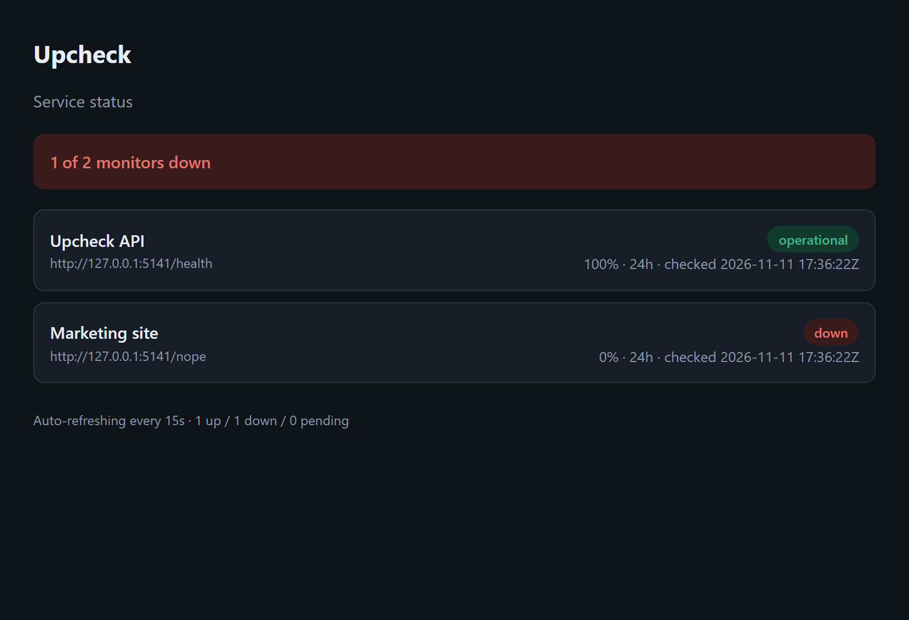

# Upcheck

[](https://github.com/BoogeyCodes/upcheck/actions/workflows/ci.yml)


A self-hosted uptime and incident monitor. Point it at your endpoints; a background scheduler probes
each one on its own interval, flips it up or down with a failure threshold that absorbs blips, opens
and resolves **incidents**, tracks **uptime** over rolling windows, and serves a live **status page**.

It's a complete ASP.NET Core 8 service: a hosted background worker, a JSON API, a server-rendered
status page, EF Core over SQLite, and a full test suite — with the monitoring logic (scheduling,
state machine, uptime maths) kept pure and exhaustively tested.



## What it does

- **Monitors** — a name, URL, check interval, per-request timeout, expected status (any 2xx by
  default) and a failure threshold.
- **Scheduled checks** — a background worker runs each monitor's check when it comes due, records the
  response time and status, and keeps a history.
- **Up/down with a threshold** — a monitor only flips to **Down** after N consecutive failures (so one
  dropped request doesn't page you), and a single success clears it. Going down **opens an incident**;
  recovering **resolves** it.
- **Uptime stats** — uptime percentage and average response time over the last 24 hours and 7 days.
- **Status page** — a self-contained HTML page (auto-refreshing) showing every monitor's current state
  and 24h uptime, with an overall operational / degraded banner.
- **API key** — mutating endpoints can be locked behind a shared `X-Api-Key`; reads stay public.

## How the monitoring works

```
SchedulerWorker (background)                MonitorRunner.RunDueAsync
   every 5s ───────────────▶  for each due monitor ─▶ IProbe.ProbeAsync (HTTP GET, per-monitor timeout)
                                                      └▶ record Check
                                                      └▶ MonitorEvaluator.Apply  (pure state machine)
                                                            ├ WentDown  → open Incident
                                                            └ Recovered → resolve Incident
```

`MonitorEvaluator` (the up/down state machine) and `UptimeCalculator` are pure functions with no
database or HTTP — so the interesting logic is tested directly. `MonitorRunner` is the schedulable
unit of work; the background service just calls it on a loop, and so do the tests.

## Design decisions

- **Failure threshold over instant flips.** Networks blip. A monitor goes Down only after
  `FailureThreshold` consecutive failures and recovers on the first success, which stops alert
  flapping. The rule lives in one pure method.
- **Pure core, isolated from infrastructure.** The scheduler, the HTTP probe and the database are all
  behind interfaces (`IClock`, `IProbe`, `AppDbContext`), so the state machine and uptime maths are
  tested with plain objects and a scripted probe — no sockets, no sleeps, no flaky timing.
- **Per-monitor timeout, not a global one.** The probe enforces each monitor's `TimeoutMs` with a
  linked `CancellationTokenSource`, and a timeout is recorded as a normal failed check.
- **Money-free but same SQLite lesson.** SQLite can't `ORDER BY` a `DateTimeOffset`, so every timestamp
  is stored as sortable UTC ticks via a value converter — ordering and windowing stay in SQL.

## Run it

```bash
dotnet run --project src/Upcheck.Api      # http://localhost:5141  (status page at /, Swagger at /swagger)
```

Create a monitor, then watch the status page. Sample requests are in [`requests.http`](requests.http).
Set `ApiKey` (config/env) to require a key on writes; the background scheduler can be turned off with
`Scheduler__Enabled=false`.

### Docker

```bash
docker build -t upcheck .
docker run --rm -p 8080:8080 -v upcheck-data:/data upcheck   # http://localhost:8080
```

## Testing

```bash
dotnet test
```

21 tests: the state machine (threshold, recovery, no flapping), the uptime calculator (percentage,
average, windowing), the due-time logic, and integration tests over HTTP that boot the real app with
a **scripted probe** — create/validate monitors, run a check, drive a monitor **down and back up** and
assert the incident opens and resolves, the status summary, the HTML status page, and the API-key gate.

## API at a glance

| Method & path | Purpose |
| --- | --- |
| `GET /api/monitors` | List monitors with current status + 24h uptime |
| `POST /api/monitors` | Create a monitor |
| `GET /api/monitors/{id}` | Detail: 24h/7d stats, recent checks, incidents |
| `PUT/DELETE /api/monitors/{id}` | Update / delete |
| `POST /api/monitors/{id}/check` | Run a check immediately |
| `GET /api/monitors/{id}/checks` · `/incidents` | History |
| `GET /api/status` | Overall + per-monitor summary |
| `GET /` | HTML status page |

## Tech

ASP.NET Core 8 Minimal APIs · hosted `BackgroundService` · EF Core 8 + SQLite · `IHttpClientFactory` ·
Serilog · Swagger / OpenAPI · xUnit + FluentAssertions · Docker · GitHub Actions.

## License

MIT
